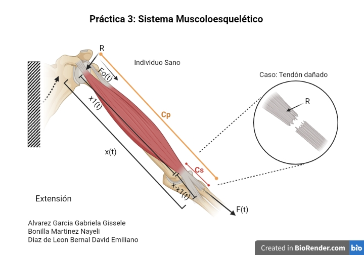
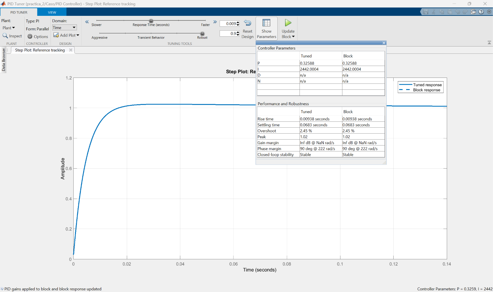

[](https://matlab.mathworks.com/open/github/v1?repo=DrPaulValle/MSFBP0)

# Práctica 3 — Modelo del sistema musculoesquelético

Repositorio académico de la asignatura **Modelado de Sistemas Fisiológicos**, correspondiente al programa de **Ingeniería Biomédica** del Tecnológico Nacional de México / Instituto Tecnológico de Tijuana. Esta práctica integra el modelado matemático mediante analogías eléctricas, análisis temporal y de estabilidad, diseño y sintonización de un controlador PI, simulación computacional mediante MATLAB/Simulink y su reproducción independiente en Python para el sistema musculoesquelético en condición sana y con lesión de tendón.

El caso de estudio representa la transmisión de fuerza en la unidad músculo–tendón durante una extensión mediante un circuito análogo con una fuente de entrada $F(t)$, una fuente dependiente $F_o(t)=\alpha F(t)$ (fuerza activa), una resistencia $R$ (viscosidad) y dos compliancias, $C_s$ (elemento elástico en serie) y $C_p$ (elemento elástico en paralelo). Se compara la fuerza de salida $F_s(t)$ del **individuo sano** (control) con la de un **individuo con tendón dañado** (caso) y se diseña un controlador que acerque la respuesta del caso a la del control.

**Docente:** Dr. Paul Antonio Valle Trujillo  
**Correo:** paul.valle@tectijuana.edu.mx  
**Departamento:** Ingeniería Eléctrica y Electrónica  
**Institución:** Tecnológico Nacional de México / Instituto Tecnológico de Tijuana  
**Asignatura:** Modelado de Sistemas Fisiológicos  
**Programa:** Ingeniería Biomédica  
**Estudiante:** David Emiliano Díaz de León Bernal · C23211564 · l23211564@tectijuana.edu.mx

**Repositorio de la asignatura:** https://github.com/DrPaulValle/MSF-IBF1020  
**Sede:** Blvd. Alberto Limón Padilla s/n, Tijuana, C. P. 22454, B. C., México.

---

<a id="contenido"></a>
## Contenido

1. [Resumen](#resumen)
2. [Competencia y objetivos](#objetivos)
3. [Relación con el temario](#temario)
4. [Modelo físico y analogía eléctrica](#analogia)
5. [Formulación matemática](#modelo)
6. [Análisis temporal y de estabilidad](#analisis)
7. [Simulación en MATLAB y Simulink](#matlab)
8. [Control en lazo cerrado y sintonización PI](#pid)
9. [Reproducción en Python](#python)
10. [Resultados y verificación cruzada](#resultados)
11. [Flujo de trabajo](#flujo)
12. [Estructura del repositorio](#estructura)
13. [Requisitos](#requisitos)
14. [Referencias](#referencias)

---

<a id="resumen"></a>
## Resumen

La práctica tiene como propósito **analizar, simular y controlar la respuesta de fuerza** del sistema musculoesquelético en dos condiciones: **Control** (individuo sano) y **Caso** (tendón dañado). El circuito equivalente integra una fuente de entrada $F(t)$, una fuente dependiente $F_o(t)=\alpha F(t)$, una resistencia $R$ y las compliancias $C_s$ y $C_p$. Ambas condiciones comparten $\alpha$, $C_s$ y $C_p$ y difieren únicamente en la resistencia: $R=100\ \Omega$ en el control y $R=10\ \mathrm{k\Omega}$ en el caso (cien veces mayor).

Mediante superposición de dos circuitos (fuente $F(t)$ y fuente $F_o(t)$) y la transformada de Laplace se obtiene la función de transferencia $F_s(s)/F(s)$, que resulta de **primer orden** con un cero. Se calculan el error en estado estacionario, el polo, el cero y las constantes de tiempo de ambas condiciones: el control responde con una constante de tiempo de $11\ \mathrm{ms}$ y el caso con $1.1\ \mathrm{s}$. Ante un pulso de fuerza de 1 s, el caso alcanza apenas $0.48$ frente al $0.75$ del control. Se diseña un **controlador PI con retroalimentación negativa** ($k_P=0.32588$, $k_I=2442.0004$) que toma la respuesta del control como referencia y reduce el error cuadrático medio de $0.166$ a $0.008$.

Los resultados se obtienen con MATLAB/Simulink (modelo `practica_3.slx`) y se reproducen en Python. Además, se programa el modelo en variables de estado y se integra con Euler explícito como comprobación independiente de la simulación en Simulink.

**Palabras clave:** sistema musculoesquelético; tendón; unidad músculo–tendón; analogía eléctrica; función de transferencia; controlador PI; MATLAB; Simulink; Python; simulación *in silico*.

[Volver al contenido](#contenido)

---

<a id="objetivos"></a>
## Competencia y objetivos

### Competencia a desarrollar

Modelar sistemas fisiológicos mediante circuitos eléctricos equivalentes, ecuaciones diferenciales y funciones de transferencia, y aplicar técnicas de control clásico para analizar y corregir alteraciones en la dinámica de la transmisión de fuerza del sistema musculoesquelético (lesión de tendón).

### Objetivo general

Modelar, simular y controlar la respuesta de fuerza $F_s(t)$ ante un pulso de entrada $F(t)$ para un individuo sano y un individuo con tendón dañado, y diseñar un controlador que acerque la respuesta del caso a la del control mediante MATLAB/Simulink y Python.

### Objetivos específicos

- Identificar entrada, salida, corrientes, voltajes y parámetros del circuito equivalente del sistema musculoesquelético.
- Analizar el circuito por superposición (circuito azul con $F(t)$ y circuito rojo con $F_o(t)$) y obtener la función de transferencia $G(s)=\frac{F_s(s)}{F(s)}$.
- Formular el modelo de ecuaciones diferenciales y su representación en variables de estado.
- Calcular el error en estado estacionario, el polo, el cero y la constante de tiempo de cada condición.
- Simular el control y el caso en lazo abierto en Simulink con el solver `ode15s` y compararlos con el circuito Simscape.
- Integrar numéricamente el modelo de EDOs en MATLAB (Euler explícito) y compararlo con Simulink.
- Sintonizar un controlador PI con retroalimentación negativa que tome la respuesta del control como referencia.
- Reproducir las respuestas de lazo abierto y lazo cerrado en Python con las mismas ganancias.
- Documentar los resultados en un repositorio de GitHub.

[Volver al contenido](#contenido)

---

<a id="temario"></a>
## Relación con el temario

| Unidad | Área | Contenidos aplicados |
|---|---|---|
| I | Sistemas de control retroalimentados | Diagramas de bloques, señal de error, lazo abierto y cerrado, error en estado estacionario, estabilidad, polos y ceros |
| II | Modelado matemático | Analogía circuito–sistema musculoesquelético, análisis por superposición, ecuaciones diferenciales, función de transferencia de primer orden |
| III | Controladores | Diseño y sintonización de un controlador PI, seguimiento de referencia |

[Volver al contenido](#contenido)

---

<a id="analogia"></a>
## Modelo físico y analogía eléctrica

El sistema musculoesquelético se estudia en una extensión: la fuerza $F(t)$ se aplica sobre la unidad músculo–tendón, que se modela con un elemento elástico en paralelo ($C_p$, asociado al músculo), un elemento elástico en serie ($C_s$, asociado al tendón), un elemento viscoso ($R$) y una fuerza activa $F_o(t)$ proporcional a la entrada. En el caso con tendón dañado, la lesión se representa aumentando $R$.



*Figura 1. Individuo sano y caso con tendón dañado. Elaborada en BioRender por Alvarez Garcia Gabriela Gissele, Bonilla Martinez Nayeli y Diaz de Leon Bernal David Emiliano.*

La analogía asocia la fuerza con el voltaje y el desplazamiento/elongación con la corriente del circuito:

| Símbolo | Equivalente eléctrico | Interpretación fisiológica |
|---|---|---|
| $F(t)$ | Fuente de voltaje de entrada | Fuerza aplicada al sistema en la extensión |
| $F_o(t)=\alpha F(t)$ | Fuente de voltaje dependiente | Fuerza activa proporcional a la entrada |
| $F_s(t)$ | Voltaje de salida (nodo de $C_p$) | Fuerza de salida del sistema |
| $F_{s1}(t)$, $F_{s2}(t)$ | Voltajes de salida por superposición | Contribución de $F(t)$ y de $F_o(t)$ a la salida |
| $x(t)$ | Corriente total | Variable de elongación total, $x=x_1+x_2$ |
| $x_1(t)$ | Corriente por $C_s$ | Elongación asociada al elemento en serie |
| $x_2(t)$ | Corriente por $R$ | Elongación asociada al elemento viscoso |
| $\alpha$ | Ganancia de la fuente dependiente | Fracción de la entrada que aporta la fuerza activa |
| $C_s$ | Capacitancia | Compliancia del elemento elástico en serie (tendón) |
| $C_p$ | Capacitancia | Compliancia del elemento elástico en paralelo (músculo) |
| $R$ | Resistencia | Viscosidad / amortiguamiento del tendón |

**Topología:** la fuente $F(t)$ alimenta la rama paralela formada por $C_s$ y por la serie (fuente $F_o$, $R$); esa rama se conecta en serie con $C_p$ a tierra. La salida $F_s(t)$ es el voltaje en $C_p$.

### Parámetros por condición

| Parámetro | Control (sano) | Caso (tendón dañado) | Unidad |
|---|---:|---:|---|
| $\alpha$ | $0.25$ | $0.25$ | — |
| $C_s$ | $10$ | $10$ | $\mu\mathrm{F}$ |
| $C_p$ | $100$ | $100$ | $\mu\mathrm{F}$ |
| $R$ | $100$ | $10\,000$ | $\Omega$ |

> **Nota sobre unidades:** fisiológicamente la entrada y la salida son fuerzas; en las simulaciones y figuras las señales se grafican en voltios, de acuerdo con la analogía eléctrica.

### Señal de entrada

Pulso rectangular de amplitud 1 entre $t=1\ \mathrm{s}$ y $t=2\ \mathrm{s}$ (cero fuera de ese intervalo), que representa una contracción sostenida de un segundo.

[Volver al contenido](#contenido)

---

<a id="modelo"></a>
## Formulación matemática

El análisis se hace por **superposición**: se estudian por separado el circuito azul (solo actúa $F(t)$, con $F_o=0$) y el circuito rojo (solo actúa $F_o(t)=\alpha F(t)$, con $F=0$), y la salida es la suma $F_s(t)=F_{s1}(t)+F_{s2}(t)$. El desarrollo a mano está en `Analisis_Matematicos.pdf`.

### 1. Circuito azul (actúa $F(t)$)

$$x(t)=x_1(t)+x_2(t),\qquad x(t)=C_p\frac{dF_{s1}(t)}{dt},\qquad x_1(t)=C_s\frac{d[F(t)-F_{s1}(t)]}{dt},\qquad x_2(t)=\frac{F(t)-F_{s1}(t)}{R}$$

Sustituyendo:

$$C_p\frac{dF_{s1}(t)}{dt}=C_s\frac{d[F(t)-F_{s1}(t)]}{dt}+\frac{F(t)-F_{s1}(t)}{R}$$

En Laplace, con condiciones iniciales nulas:

$$\left(C_ps+C_ss+\frac{1}{R}\right)F_{s1}(s)=\left(C_ss+\frac{1}{R}\right)F(s)\;\Rightarrow\;\frac{F_{s1}(s)}{F(s)}=\frac{C_sRs+1}{R(C_p+C_s)s+1}$$

### 2. Circuito rojo (actúa $F_o(t)=\alpha F(t)$)

Las compliancias $C_p$ y $C_s$ quedan en serie con $R$ y la fuente, con capacitancia equivalente $C_p+C_s$:

$$-\alpha F(t)=R\,x(t)+\frac{1}{C_p+C_s}\int x(t)\,dt,\qquad F_{s2}(t)=\frac{1}{C_p+C_s}\int x(t)\,dt$$

En Laplace:

$$-\alpha F(s)=R\,X(s)+\frac{X(s)}{(C_p+C_s)s},\qquad F_{s2}(s)=\frac{X(s)}{(C_p+C_s)s}\;\Rightarrow\;\frac{F_{s2}(s)}{F(s)}=\frac{-\alpha}{R(C_p+C_s)s+1}$$

### 3. Función de transferencia total

Sumando ambas contribuciones:

$$\boxed{G(s)=\frac{F_s(s)}{F(s)}=\frac{C_sRs+1-\alpha}{R(C_p+C_s)s+1}}$$

El denominador es de **primer orden**: aunque hay dos compliancias, solo una variable de estado es independiente (el voltaje en $C_s$ queda determinado por $F$ y $F_s$).

### 4. Modelo en variables de estado (EDOS)

Se define $\beta=\dfrac{C_s}{C_p+C_s}$ y la constante de tiempo $\tau=R(C_p+C_s)$. Como $C_sRs=\beta\,\tau s$, la función de transferencia se puede reescribir separando un término directo:

$$G(s)=\frac{C_sRs+1-\alpha}{\tau s+1}=\frac{\beta(\tau s+1)+1-\alpha-\beta}{\tau s+1}=\beta+\frac{1-\alpha-\beta}{\tau s+1}$$

Se introduce el estado $X(s)=\dfrac{F(s)}{\tau s+1}$ (variable `x` en el código; se escribe $z$ en la sección de Euler para no confundirlo con la corriente $x(t)$ del circuito). De $(\tau s+1)X(s)=F(s)$ se obtiene, en el dominio del tiempo,

$$\tau\frac{dx(t)}{dt}+x(t)=F(t)\;\Rightarrow\;\frac{dx(t)}{dt}=-\frac{x(t)}{\tau}+\frac{F(t)}{\tau}$$

La salida se recupera sustituyendo $X(s)$ en $G(s)$:

$$F_s(s)=\beta F(s)+X(s)\,(1-\alpha-\beta)$$

y aplicando la transformada inversa de Laplace:

$$F_s(t)=\beta F(t)+x(t)\,(1-\alpha-\beta)$$

Sustituyendo los coeficientes, el modelo queda:

$$\boxed{\frac{dx(t)}{dt}=-\frac{x(t)}{R(C_p+C_s)}+\frac{F(t)}{R(C_p+C_s)}}$$

$$\boxed{F_s(t)=\frac{C_s}{C_p+C_s}F(t)+x(t)\left(1-\alpha-\frac{C_s}{C_p+C_s}\right)}$$

Estas expresiones son exactamente las que programan la función `musculoesqueletico` de MATLAB y la integración de Euler de la sección de simulación.

[Volver al contenido](#contenido)

---

<a id="analisis"></a>
## Análisis temporal y de estabilidad

### 1. Error en estado estacionario ($e_{ss}$)

Para una entrada escalón unitario $F(s)=\frac{1}{s}$:

$$e_{ss}=\lim_{s\to0}sF(s)[1-G(s)]=1-G(0)=1-(1-\alpha)=\alpha=0.25$$

La ganancia en continua es $G(0)=1-\alpha=0.75$ **para ambos individuos**, de modo que en lazo abierto el error entre entrada y salida es $0.25\ \mathrm{V}$. Como el control y el caso tienen la misma ganancia en continua, la diferencia entre ellos en régimen permanente es nula; la discrepancia observada es **dinámica** (velocidad de respuesta), no de nivel final.

### 2. Polo, cero y constante de tiempo

El polo es $s=-\frac{1}{R(C_p+C_s)}$ y el cero es $s=-\frac{1-\alpha}{C_sR}$. El valor inicial tras un escalón es $G(\infty)=\frac{C_s}{C_p+C_s}=0.0909$.

| Individuo | $R$ | $\tau=R(C_p+C_s)$ | Polo | Cero | Comportamiento |
|---|---:|---:|---:|---:|---|
| Control | $100\ \Omega$ | $11\ \mathrm{ms}$ | $-90.909$ | $-750$ | Estable, primer orden, rápido |
| Caso | $10\ \mathrm{k\Omega}$ | $1.1\ \mathrm{s}$ | $-0.909$ | $-7.5$ | Estable, primer orden, lento |

Ambos tienen su polo real negativo, por lo que **son estables**. Al ser sistemas de primer orden no presentan oscilación ni sobreimpulso. El aumento de $R$ en un factor de 100 reduce el polo en el mismo factor y vuelve la respuesta del caso 100 veces más lenta.

### 3. Respuesta analítica ante escalón

$$F_s(t)=(1-\alpha)+\left[\frac{C_s}{C_p+C_s}-(1-\alpha)\right]e^{-t/\tau}=0.75-0.659\,e^{-t/\tau}$$

Para el pulso de 1 s, el control prácticamente alcanza su valor final ($4\tau=44\ \mathrm{ms}\ll1\ \mathrm{s}$), mientras que el caso solo recorre una fracción: $F_{sY}(2\ \mathrm{s})=0.75-0.659\,e^{-1/1.1}\approx0.484$, valor que coincide con la simulación.

[Volver al contenido](#contenido)

---

<a id="matlab"></a>
## Simulación en MATLAB y Simulink

La simulación se ejecuta desde el cuaderno (live script) de MATLAB cargando el modelo `practica_3.slx` con los siguientes parámetros:
- **Tiempo de simulación:** $t = 15\text{ s}$
- **Solver:** `ode15s`
- **Paso máximo (`Maxstep`):** $1\times 10^{-2}\text{ s}$
- **Condiciones iniciales:** nulas

El modelo entrega al Workspace las señales: `t`, `F` (entrada), `Fsx` (control), `Fsy` (caso) y `PID` (caso con tratamiento).

```matlab
clc; clear; close all; warning('off','all')
open_system("practica_3.slx")
parameters.Stoptime='15';
parameters.Solver='ode15s';
parameters.Maxstep='1e-2';
x = sim('practica_3',parameters);

plotsignals(x.t, x.F, x.PID, x.Fsy, x.Fsx, 'Respuestas')
```

### Modelo de Simulink

- **Subsistema Control** (individuo sano): recibe $F(t)$ y entrega dos salidas, `Control CE` (circuito eléctrico de Simscape con fuente de voltaje controlada, ganancia $0.25$, resistencia, capacitores y sensor de voltaje) y `Control FT` (bloque de función de transferencia). Ambas se grafican juntas para comprobar que el circuito y la función de transferencia coinciden.
- **Subsistema Caso** (tendón dañado): contiene el mismo circuito con $R=10\ \mathrm{k\Omega}$ (`Caso CE` y `Caso FT`) y, además, el lazo de control: la señal `Control` (referencia) entra a un sumador, se resta la salida del bloque `Tratamiento` (la misma función de transferencia del caso), el error pasa por el bloque `PI(s)` y alimenta a `Tratamiento`, cuya salida es `PID(t): Caso`.

### Señales de error

$$e_{caso}(t)=F_{sX}(t)-F_{sY}(t)\ \text{(lazo abierto)},\qquad e(t)=F_{sX}(t)-PID(t)\ \text{(con tratamiento)}$$

### Comprobación independiente: modelo de EDOs con Euler explícito

El modelo en variables de estado se integra directamente en MATLAB con $\Delta t = 10^{-3}\text{ s}$ en $0\le t\le 10$ s, con condiciones iniciales nulas. La entrada es el pulso entre 1 y 2 s y la señal `PID` de Simulink se interpola a ese paso con `interp1(...,'previous')`:

$$z[k+1]=z[k]+\frac{F[k]-z[k]}{R(C_p+C_s)}\,\Delta t$$

$$F_s[k+1]=\frac{C_s}{C_p+C_s}F[k]+\left(1-\alpha-\frac{C_s}{C_p+C_s}\right)z[k]$$

```matlab
dt = 1e-3;
t = (0:dt:10)';
F = zeros(length(t),1); F(1/dt:2/dt) = 1;
PID = interp1(x.t,x.PID,t,'previous');

par_control = [0.25,10e-6,100e-6,100];    % [alpha, Cs, Cp, R]
par_caso    = [0.25,10e-6,100e-6,10e3];

Fs_control = musculoesqueletico(par_control,F,t);
Fs_caso    = musculoesqueletico(par_caso,F,t);

plotsignals(t,F,PID,Fs_caso,Fs_control,'EDOsys')
```

La función `musculoesqueletico(par,F,t)` recibe el vector de parámetros $[\alpha,\,C_s,\,C_p,\,R]$, la entrada y el vector de tiempo, y aplica las dos ecuaciones anteriores. Con $\Delta t=1\ \mathrm{ms}$ y la constante de tiempo más pequeña $\tau=11\ \mathrm{ms}$, el cociente $\Delta t/\tau\approx0.09$ es mucho menor que 2, por lo que el método explícito es numéricamente estable.

La función `plotsignals` grafica cuatro señales (entrada continua, tratamiento discontinuo, caso punteado y control punto-raya) con ejes $0\le t\le10$ s y $-0.4\le F\le1.2$ V, y exporta la figura en PDF vectorial con el nombre `<signal>_matlab.pdf`.

[Volver al contenido](#contenido)

---

<a id="pid"></a>
## Control en lazo cerrado y sintonización PI

### 1. Retroalimentación negativa

La referencia es la respuesta del control, así que el error del lazo es

$$e(t)=F_{sX}(t)-PID(t)$$

y, con $K(s)$ el controlador y $G_{caso}(s)$ la planta del caso, la función de transferencia de lazo cerrado es

$$T(s)=\frac{K(s)G_{caso}(s)}{1+K(s)G_{caso}(s)}$$

### 2. Estructura y criterios de diseño

Se emplea un controlador **PI** (el término derivativo no se usa):

$$K(s)=k_P+\frac{k_I}{s}=\frac{k_Ps+k_I}{s}$$

La sintonización se realizó con la herramienta **PID Tuner** de Simulink sobre el bloque `PI(s)` del subsistema Caso, con tiempo de respuesta de $0.009\ \mathrm{s}$ (comparable con la constante de tiempo del control, $11\ \mathrm{ms}$) y comportamiento transitorio de $0.9$ (hacia robusto). El integrador garantiza error nulo en estado estacionario ante referencia escalón.



*Figura 2. PID Tuner: parámetros del controlador y desempeño en seguimiento de referencia.*

### 3. Ganancias del controlador

| Caso | $k_P$ | $k_I$ | $k_D$ |
|---|---:|---:|---:|
| Caso (tendón dañado) | 0.32588 | 2442.0004 | — |

### 4. Métricas obtenidas (escalón unitario en lazo cerrado)

| Métrica | PID Tuner |
|---|---:|
| Tiempo de subida | 9.38 ms |
| Tiempo de establecimiento | 68.3 ms |
| Sobreimpulso | 2.45 % |
| Pico | 1.02 |
| Margen de ganancia | $\infty$ |
| Margen de fase | 90° @ 222 rad/s |
| Estabilidad en lazo cerrado | Estable |

### 5. Polos y ceros en lazo cerrado

Con $G_{caso}(s)=\frac{0.1s+0.75}{1.1s+1}$, la ecuación característica es

$$(1.1+0.1k_P)s^2+(1+0.75k_P+0.1k_I)s+0.75k_I=0\;\Rightarrow\;1.133\,s^2+245.44\,s+1831.5=0$$

| Elemento | Valores |
|---|---|
| Polos de lazo cerrado | $-7.738,\; -208.97$ |
| Ceros de lazo cerrado | $-7.5,\; -7493.6$ |

Los dos polos son reales y negativos (lazo cerrado estable y sobreamortiguado). El polo lento en $-7.738$ queda muy cerca del cero de la planta en $-7.5$, por lo que su efecto se cancela casi por completo; el polo en $-208.97$ domina la respuesta y es más de 200 veces más rápido que el polo del caso en lazo abierto ($-0.909$). Como $T(0)=1$, el error en estado estacionario en lazo cerrado es nulo.

[Volver al contenido](#contenido)

---

<a id="python"></a>
## Reproducción en Python

El script `practica_3.py` reproduce los resultados con una segunda herramienta. Sus apartados son:

1. **Datos de la simulación:** $t\in[0,10]$ s con $\Delta t=10^{-3}$ s ($N=10\,001$ muestras) y entrada `u` igual a 1 entre $t=1$ s y $t=2$ s.
2. **Función de transferencia del control:** `num=[Cs*R, 1-a]`, `den=[R*(Cp+Cs), 1]` con $R=100\ \Omega$.
3. **Función de transferencia del caso:** las mismas expresiones con $R=10\ \mathrm{k\Omega}$.
4. **Controlador PI:** `kP, kI = 0.3258, 2442.000353`, `numPID=[kP,kI]`, `denPID=[1,0]`.
5. **Lazo cerrado:** `ctrl.feedback(ctrl.series(PID,sys_caso),1,sign=-1)`.
6. **Respuestas:** `ctrl.forced_response` para el control y el caso con la entrada `u`, y para el lazo cerrado usando como referencia la salida del control (`Fsx`).
7. **Figura:** curvas de $F(t)$, control, caso y tratamiento en ejes $0\le t\le10$ s y $-0.1\le F\le1.2$ V, guardada como `respuesta_practica3_python.pdf`.

El script imprime las funciones de transferencia del control, del caso, del controlador y del lazo cerrado; esta última es $\frac{0.03258s^2+244.4s+1832}{1.133s^2+245.4s+1832}$, consistente con el análisis de la sección anterior.

Para ejecutarlo:

```bash
pip install numpy control matplotlib
python practica_3.py
```

[Volver al contenido](#contenido)

---

<a id="resultados"></a>
## Resultados y verificación cruzada

### Archivos de resultados

| Figura | MATLAB/Simulink | Python |
|---|---|---|
| Control, caso y tratamiento (Simulink) | [Respuestas_matlab.pdf](Respuestas_matlab.pdf) | [respuesta_practica3_python.pdf](respuesta_practica3_python.pdf) |
| Modelo de EDOs (Euler) | [EDOsys_matlab.pdf](EDOsys_matlab.pdf) | — |

> Los PDF se enlazan para su consulta porque GitHub no los presenta como imágenes incrustadas.

### Desempeño ante el pulso de 1 s

| Señal | Valor |
|---|---|
| Control $F_{sX}$ (valor final alcanzado) | $0.75$ en ≈ 42 ms (98 %) |
| Caso $F_{sY}$ (valor al terminar el pulso) | $0.484$ |
| Caso con tratamiento (valor máximo) | $0.764$ (1.8 % sobre la referencia $0.75$) |
| Error $e_{caso}$ en lazo abierto, $1.1\le t<2$ s | hasta $0.60$ |
| Error $e(t)$ con PI, $1.1\le t<2$ s | hasta $0.012$ |
| Error máximo con PI (transitorio inicial) | $0.165$ |
| Tiempo para que el error con PI entre en la banda de 2 % | ≈ 28 ms |
| RMSE sobre $0\le t\le10$ s, lazo abierto | $0.166$ |
| RMSE sobre $0\le t\le10$ s, con PI | $0.008$ (reducción de ≈ 95 %) |

### Interpretación de los resultados

**Lazo abierto.** El individuo sano responde casi de inmediato al pulso: con $\tau=11\ \mathrm{ms}$ alcanza el nivel $G(0)=0.75$ en unas decenas de milisegundos y regresa a cero en cuanto termina la entrada. El caso con tendón dañado tiene la misma ganancia en continua, pero su constante de tiempo es de $1.1\ \mathrm{s}$ porque $R$ es cien veces mayor; en el segundo que dura el pulso solo llega a $0.48$ y después decae lentamente durante varios segundos. Fisiológicamente, esto equivale a una transmisión de fuerza retardada y amortiguada: el tendón dañado disipa y retiene la fuerza en lugar de transmitirla, de modo que la fuerza útil es menor y se prolonga una vez terminada la contracción. Ambos sistemas son estables y de primer orden, por lo que no hay oscilaciones.

**Efecto del PI.** Con retroalimentación negativa y la referencia del control, el controlador sustituye el polo lento del caso ($-0.909$) por un polo efectivo en $-208.97$ (el polo en $-7.738$ queda cancelado por el cero), es decir, acelera la respuesta del caso en un factor superior a 200. La curva del tratamiento queda prácticamente superpuesta a la del control: el error en la zona de meseta no pasa de $0.012$ y el único error apreciable es el transitorio de los primeros $\approx28\ \mathrm{ms}$ tras cada flanco, con un sobreimpulso de 1.8 % en el pulso (2.45 % en el escalón unitario). El RMSE baja de $0.166$ a $0.008$.

**Consideraciones de control.** La parte integral anula el error en estado estacionario ($T(0)=1$) y el margen de fase de $90^\circ$ indica una buena robustez. El costo es una acción de control mucho más agresiva que la dinámica natural del tejido: en un sistema real, forzar a un tendón lesionado a responder 200 veces más rápido requeriría fuerzas o actuación que podrían no ser fisiológicamente alcanzables, por lo que este resultado debe leerse como una demostración *in silico* del principio de control.

**Limitaciones del modelo.** El modelo es lineal, de primer orden y con parámetros concentrados; no incluye no linealidades del tejido (rigidez dependiente de la elongación, saturación de la fuerza muscular) ni variaciones en el tiempo de la lesión, y la lesión se representa con un solo cambio en $R$.

### Notas de verificación

- **Controlador en Python vs. PID Tuner:** el script usa `kP = 0.3258` (truncado) y el PID Tuner reporta `0.32588`. La diferencia es menor al $0.03\ \%$ y no altera las métricas: ambos dan sobreimpulso de 2.45 % y tiempo de subida de 9.4 ms.
- **Tiempo de establecimiento:** el PID Tuner reporta 68.3 ms; al evaluar la respuesta al escalón en Python con banda de 2 % se obtienen ≈ 64.5 ms. La diferencia depende de la definición de la banda de establecimiento.
- **Señal `PID` en el modelo de EDOs:** en MATLAB solo se integran con Euler el control y el caso; la señal del tratamiento proviene de Simulink (interpolada con `interp1` y `'previous'`). La verificación independiente del lazo cerrado se hace con Python.
- **Orden de las señales:** `plotsignals` en MATLAB grafica $F$, `PID`, `Fsy`, `Fsx`, mientras que Python grafica $F$, `Fsx`, `Fsy`, `PID`; además, los ejes verticales difieren (MATLAB: $-0.4$ a $1.2$ V; Python: $-0.1$ a $1.2$ V) y también la asignación de colores.
- **Guardado de la figura en Python:** `fg.savefig` se ejecuta antes de `plt.show()`, para evitar que se guarde una figura vacía en algunos entornos.

[Volver al contenido](#contenido)

---

<a id="flujo"></a>
## Flujo de trabajo

### Etapa 1. Formulación y análisis
1. Identificar en el circuito $F(t)$, $F_o(t)$, $F_s(t)$, $x(t)$, $x_1(t)$, $x_2(t)$, $\alpha$, $C_s$, $C_p$ y $R$.
2. Analizar por superposición el circuito azul y el circuito rojo.
3. Obtener la función de transferencia $F_s(s)/F(s)$ y el modelo en variables de estado.
4. Calcular el error en estado estacionario, el polo, el cero y la constante de tiempo de cada individuo.

### Etapa 2. Simulación de los individuos
1. Ejecutar `practica_3.slx` con $t_{end}=15$ s, `ode15s` y `Maxstep = 1e-2`.
2. Comparar en Simulink el circuito (Simscape) con la función de transferencia.
3. Programar el modelo de EDOs con Euler explícito y comparar sus resultados con los de Simulink.

### Etapa 3. Diseño y comprobación del controlador
1. Definir la señal de error respecto al individuo de control.
2. Implementar el lazo con retroalimentación negativa y sintonizar el PI con PID Tuner.
3. Registrar $k_P$ y $k_I$ y las métricas de desempeño.
4. Graficar las respuestas en MATLAB y exportarlas a PDF.
5. Reproducir las respuestas en Python con las mismas ganancias.

### Etapa 4. Documentación
1. Comparar MATLAB y Python.
2. Redactar la interpretación de los resultados y sus limitaciones.
3. Publicar los archivos y un `CITATION.cff` correctamente identificados en GitHub.

[Volver al contenido](#contenido)

---

<a id="estructura"></a>
## Estructura del repositorio

```text
.
├── README.md                               # Reporte y guía de reproducción
├── CITATION.cff                            # Datos de citación del repositorio
├── DiazdeLeonDavidC23211564.pdf            # Exportación del cuaderno MATLAB
├── practica_3.py                           # Implementación en Python
├── practica_3.slx                          # Modelo Simulink
├── Analisis_Matematicos.pdf                # Desarrollo analítico a mano
├── Respuestas_matlab.pdf
├── EDOsys_matlab.pdf
├── respuesta_practica3_python.pdf
├── Esquema_musculoesqueletico.jpeg
└── PID_Tuner.png
```

Si se usan otros nombres o subcarpetas, actualizar las rutas del README.

[Volver al contenido](#contenido)

---

<a id="requisitos"></a>
## Requisitos

### Software

- MATLAB y Simulink (con Simscape Electrical para los subsistemas de circuito), con el modelo `practica_3.slx` y el cuaderno de la práctica.
- Python (por ejemplo, con Visual Studio Code) y las bibliotecas `numpy`, `control` y `matplotlib`.
- Git y GitHub para presentar el repositorio.

Las versiones mínimas del software no se especifican en el instructivo.

### Secuencia de reproducción

1. Consultar el repositorio general de la asignatura y descargar los archivos de la práctica.
2. Verificar los valores de $\alpha$, $C_s$, $C_p$ y $R$ de cada individuo y las condiciones iniciales.
3. Derivar el modelo y completar el análisis de error, polo y cero.
4. Ejecutar el cuaderno de MATLAB: simulación, modelo de EDOs y figuras en PDF.
5. Ejecutar `practica_3.py` para obtener la figura en Python.
6. Comparar las figuras de MATLAB y Python.
7. Publicar el repositorio junto con su `CITATION.cff`.

### Resultados mínimos esperados

| Entregable | Evidencia solicitada |
|---|---|
| Formulación matemática | Superposición, función de transferencia y modelo en variables de estado |
| Análisis del sistema | Error en estado estacionario, polo, cero y estabilidad del control y del caso |
| Simulación | Modelo `.slx`, respuestas en lazo abierto y modelo de EDOs |
| Control | Ganancias del PI, métricas y respuesta en lazo cerrado |
| Python | Código `.py` y figura |
| Documentación | `README.md`, `CITATION.cff` e interpretación de los resultados |

### Criterios de presentación académica

Debe distinguirse entre resultados de referencia reproducidos y aportes o modificaciones propias. La ejecución de scripts y la generación de figuras no sustituyen la discusión del comportamiento fisiológico, matemático y de control del sistema.

[Volver al contenido](#contenido)

---

<a id="referencias"></a>
## Referencias

[1] P. A. Valle, *Práctica 3: Sistema musculoesquelético*, instructivo de la asignatura Modelado de Sistemas Fisiológicos, Tecnológico Nacional de México / Instituto Tecnológico de Tijuana.

[2] M. C. Khoo, *Physiological Control Systems: Analysis, Simulation, and Estimation*, 2nd ed., IEEE Press, 2018.

[3] F. C. Hoppensteadt y C. S. Peskin, *Modeling and Simulation in Medicine and the Life Sciences*, Springer.

[4] J. E. Hall, *Guyton and Hall Textbook of Medical Physiology*, 14th ed., Elsevier, 2021.

[5] K. Ogata, *Ingeniería de Control Moderna*, 5.ª ed., Pearson Educación, 2010.

[6] N. S. Nise, *Control Systems Engineering*, 8th ed., John Wiley & Sons, 2020.

[7] P. A. Valle, *Syllabus para Modelado de Sistemas Fisiológicos*, Tecnológico Nacional de México / Instituto Tecnológico de Tijuana, Tijuana, B. C., México, 2026. Disponible en: https://biomath.xyz/course/

[8] Tecnológico Nacional de México, *Programa de estudio de la asignatura Modelado de Sistemas Fisiológicos*, IBF-1020.

---

## Uso académico

Este repositorio se utiliza como evidencia de una práctica de Modelado de Sistemas Fisiológicos. Su finalidad es desarrollar habilidades de modelado, análisis, simulación y diseño de control, y de documentación técnica; cualquier cambio de parámetros, estructura del controlador o procedimiento debe identificarse y justificarse.
